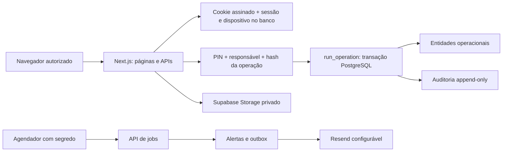

# Arquitetura

Next.js App Router com componentes de servidor para leituras. Componentes de cliente cuidam de navegação, tema e formulários. TanStack Table organiza a prévia de importações. Radix controla modais acessíveis. Não há Supabase administrativo no bundle do cliente.

`src/lib/domain` define comandos, recursos, validações e utilitários puros. `src/lib/server` isola credenciais, autenticação, acesso e e-mail com `server-only`. APIs verificam sessão antes de consultas e Origin antes de mutations. Páginas com dados também verificam sessão, além do layout; layouts Next não substituem autorização junto ao acesso aos dados.

`run_operation` revalida sessão/dispositivo, bloqueia a chave de operação, valida confirmação e consome-a dentro da mesma transação. A resposta é persistida para retries. Operações de estoque bloqueiam lotes; ferramentas têm trava por linha e índice único de retirada aberta. Erros de concorrência são apresentados para revisão.

Formulários de edição têm versão otimista. Operações incrementais (estoque, retiradas, devoluções) validam o estado atual na transação. Auditoria contém antes/depois e responsável informado. Credenciais e tentativas são tabelas separadas que não passam pelo trigger de auditoria operacional.

Não há cache de dados operacionais no cliente nem alterações offline. `router.refresh()` a cada 60s em abas visíveis é o fallback entre dispositivos. Todas as exportações/downloads são autenticados. URLs assinadas expiram em 60s, mas não têm revogação instantânea.

A operação SQL usa whitelist de entidades/colunas. O esquema TypeScript derivado é uma fotografia do banco; os repositórios dinâmicos usam whitelist + Zod, e ainda não utilizam integralmente os tipos gerados.
