# Banco de dados

Migrations versionadas em `supabase/migrations`, aplicadas em ordem. Datas persistidas em `timestamptz`; apresentação usa America/Sao_Paulo. Colunas de negócio possuem UUID, timestamps, versão e arquivamento; eventos e tabelas de segurança usam modelos específicos. Quantidades PostgreSQL são `numeric`; as entradas da UI são limitadas por Zod. Para quantidades com precisão financeira além do uso operacional, adotar aritmética decimal no cliente antes de expandir a escala.

```mermaid
erDiagram
 authorized_devices ||--o{ access_sessions : authorizes
 access_sessions ||--o{ confirmations : binds
 mechanics ||--o{ confirmations : declares
 confirmations ||--o| operation_results : authorizes
 mechanics ||--o{ audit_events : informed_actor
 locations ||--o{ locations : parent
 locations ||--o{ stock_lots : stores
 part_catalog ||--o{ stock_lots : batches
 part_catalog ||--o{ part_instances : serializes
 organizations ||--o{ stock_lots : owns_supplies
 stock_lots ||--o{ stock_reservations : reserves
 stock_lots ||--o{ stock_movements : moves
 physical_counts ||--o{ physical_count_items : counts
 tools ||--o{ tool_checkouts : lends
 tools ||--o{ tool_calibrations : calibrates
 tools ||--o{ tool_discrepancies : tracks
 tool_kits ||--o{ tool_kit_items : contains
 tools ||--o| tool_kit_items : belongs
 aircraft ||--o{ maintenance_tasks : relates
 aircraft ||--o{ work_orders : relates
 work_orders ||--o{ maintenance_tasks : groups
 external_shipments ||--|{ external_shipment_items : sends
 external_shipments ||--o{ external_tracking_events : tracks
 documents ||--o{ document_versions : versions
 documents ||--o{ document_links : references
 alerts ||--o{ email_deliveries : notifies
 notification_recipients ||--o{ email_deliveries : receives
 import_jobs ||--o{ import_job_rows : records
```

`P/N` identifica catálogo; `S/N` é único no catálogo. O catálogo permite P/N igual de fabricantes distintos; registros sem fabricante devem ser conferidos manualmente para evitar duplicação semântica. Lote é único por catálogo/código/local. Patrimônio de ferramenta e matrícula atual têm unicidade própria; alterações de matrícula ficam na auditoria.

`quantity` é físico; `reserved` é parte dele. Reservar não dá baixa. Consumo e transferência só usam físico menos reservado, com condição utilizável registrada, documentação completa e validade vigente. Recebimentos entram pendentes. Retornos externos criam lote separado pendente, preservando a condição do material que permaneceu no hangar.

Uma peça serializada tem local atual ou vínculo à aeronave; instalação exige aeronave e remove local físico. Remoção limpa vínculo e devolve condição/documentação a pendente. Local desconhecido limpa a localização antiga e gera alerta no próximo job.

`tool_checkouts` possui índice único parcial `returned_at is null`. Uma ferramenta pertence a um kit atual; o banco evita retiradas individuais de ferramenta em kit. Retorno de kit com falta cria ocorrência, preservada após reconhecimento do alerta.

Não há saldo derivado paralelo. Histórico não é apagado por ajustes. Audit events proíbem UPDATE/DELETE por trigger e não concedem UPDATE/DELETE/TRUNCATE ao service role. RLS está ativa sem políticas de leitura pública. `anon`/`authenticated` não acessam dados nem RPCs de negócio.

Gere tipos após migrations com `npm run db:types`, usando variáveis `PG*` ou `DATABASE_URL` em ambiente seguro. A introspecção lê apenas `information_schema` do esquema público. O diagrama resume as relações centrais; SQL e tipos gerados contêm as 42 tabelas completas.
